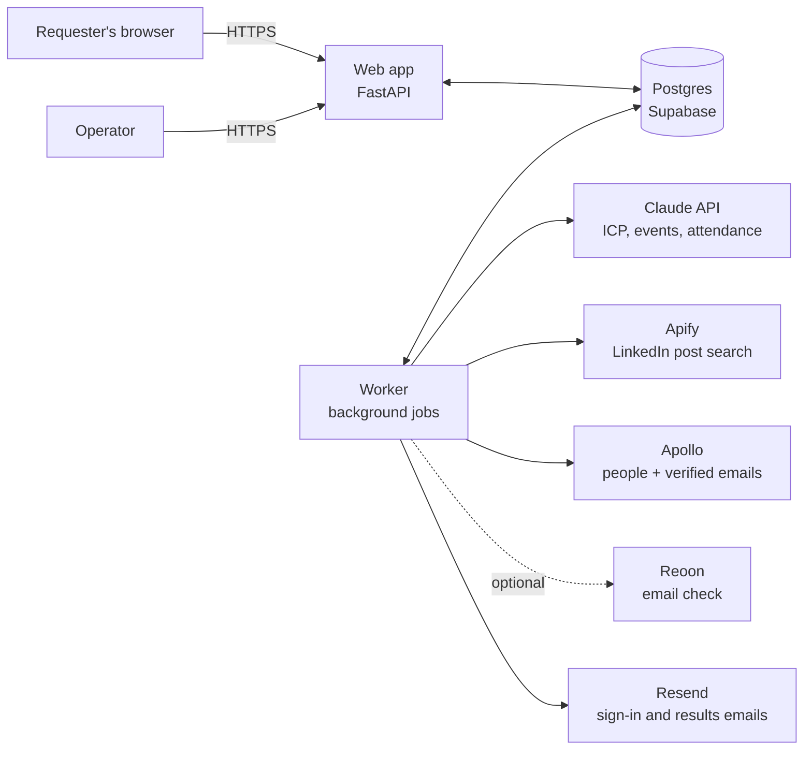
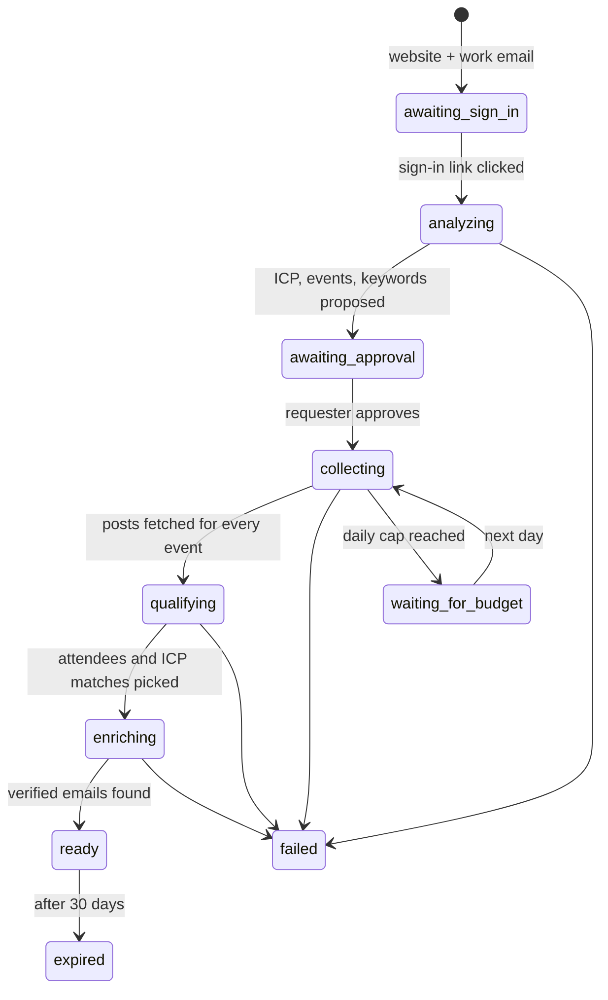

# Architecture

## The big picture

Two processes from one codebase and one Docker image:

- **Web** serves pages and the operator console. It never calls an outside service, not even to send email: it writes
  jobs (and outbox emails) to the database, and the worker does the rest. A slow or failing provider therefore can't
  slow down or break a page.
- **Worker** runs the pipeline as a sequence of jobs. Several workers can run at once.

Postgres is the only stateful piece. It holds the data, the job queue, the spend ledger and the rate-limit counters,
so there is no Redis to run (see [ADR 0002](adr/0002-postgres-job-queue.md)).

## The pipeline

Each run moves through these states. Every arrow is one background job, and every job can safely run twice.

1. **analyze**: fetch the website safely (see Security), ask Claude for the ICP and keywords, then ask Claude with web
   search for real events. Results are stored on the run for the requester to edit.
2. **collect**: for each approved event, one Apify run with its keyword searches, capped by `maxTotalChargeUsd`. Posts
   go into a shared cache keyed by event and query, so the next company asking about the same event reuses them.
3. **qualify**: cheap text rules label the obvious posts; Claude labels the rest in batches. Labels are cached per
   post and event. People whose headline can't match the ICP are dropped before any paid lookup.
4. **enrich**: Apollo bulk match by LinkedIn URL (10 people per call), cached per person. ICP scoring on the enriched
   title, seniority, industry and company size. Only verified emails are kept.
5. **deliver**: the results link is emailed and the run is marked ready.

## Data model (main tables)

| Table | Holds |
|---|---|
| `accounts`, `login_tokens`, `sessions` | Requesters and operators; one-time sign-in tokens and sessions, stored hashed |
| `runs` | One per company request: website, status, ICP, proposed and approved events, cost so far |
| `events`, `run_events` | Canonical events, and which events (and keywords) a run uses |
| `posts`, `event_posts`, `search_cache` | The shared post cache and which searches already ran |
| `post_labels` | Attendance label per post and event, with the method (rule or model) |
| `people` | One row per LinkedIn profile with cached Apollo data |
| `run_leads` | The final list for a run, with ICP score and reasons |
| `jobs` | The job queue |
| `spend`, `budget_days` | Every paid call, and the running total per day for the daily cap |
| `rate_limits` | Fixed-window counters for sign-up and sign-in attempts |

## Cost controls

- Nothing runs before the requester signs in. The analyze step then runs before approval, because it produces the
  plan the requester approves. It calls only Claude, has its own cap ($0.50, part of the run's $3) and counts toward
  the daily cap. Apify, Apollo and Reoon run only after the requester approves.
- Dollar-billed calls (Apify, Claude) first **reserve** their estimated cost against the run's cap and the day's cap in one database
  transaction (row lock on today's budget), so two workers can't both squeeze under the limit. Actual cost is
  settled afterwards.
- Apify runs carry `maxTotalChargeUsd`, so even a runaway search can't exceed its reservation.
- Credit-billed calls have their own per-run counters: Apollo lookups (150 per run) and, when enabled, Reoon checks
  (one per delivered lead). Resend's free tier covers our email volume; sign-ins are rate-limited per IP and email.
- Caches mean popular events and people are paid for once.

## Scaling to 10,000 users

The web tier is stateless; add replicas. The real limits are external:

| Constraint | At 500 runs/day | Plan |
|---|---|---|
| Apify spend | ≈ 300,000 posts/day before caching | Event cache, query caps, daily budget |
| Apollo | ≈ 75,000 lookups/day before caching | Person cache, ICP pre-screen before lookup |
| Claude | ≈ 15,000 classification calls/day | Rules first, batches of 25 posts, label cache |
| Postgres connections | Supabase pooler limits | Small pools per process (5 + 5 overflow) |
| Database size | ≈ 1 MB per run | 30-day retention for results and raw posts; Supabase Pro at scale |

A load test in the QA repo checks the web tier at 500 concurrent users and the queue with 1,000 runs (fake providers).

## Security

- **Sign-in:** one-time links, hashed in the database, 30-minute expiry, single use. Sessions are random tokens in an
  HttpOnly, Secure, SameSite=Lax cookie, stored hashed and revocable.
- **Authorization:** a run and its leads are visible only to the account that created it and to operators.
- **CSRF:** every form carries a token checked against the session.
- **SSRF:** the website fetcher resolves the host itself, refuses private, loopback, link-local and reserved
  addresses, connects to the address it checked (no DNS rebinding), re-checks every redirect, and caps size and time.
- **Headers:** strict Content-Security-Policy, HSTS, no framing.
- **Secrets:** only in environment variables (Railway); never in the repo or logs.
- **Logs:** identify people by internal IDs (account, run, person). Lead data (names, emails, LinkedIn URLs) and
  sign-in links are never logged. A requester's email appears only masked (`j***@acme.example`, via `mask_email`),
  on the sign-in and rate-limit lines written before an account exists.
- **Data retention:** personal data in results and caches is deleted after 30 days.

## Environments

| Environment | Where | Providers | Database |
|---|---|---|---|
| Local | your machine | fakes | local Postgres |
| Preview | Railway, one per pull request | fakes | Railway Postgres (throwaway) |
| Staging | Railway `staging` | real, tiny caps | separate database |
| Production | Railway `production`, `events.theb2bdynamics.com` | real | Supabase |

Fakes are deterministic stand-ins for every provider, so previews and the QA suite can run the whole pipeline end to
end without spending money ([ADR 0003](adr/0003-providers-behind-interfaces.md)).

## Observability

JSON logs with request, run and job IDs; error tracking in Sentry; `/healthz` (process up) and `/readyz` (database
reachable) for Railway's health checks; the operator console for run and spend status.
