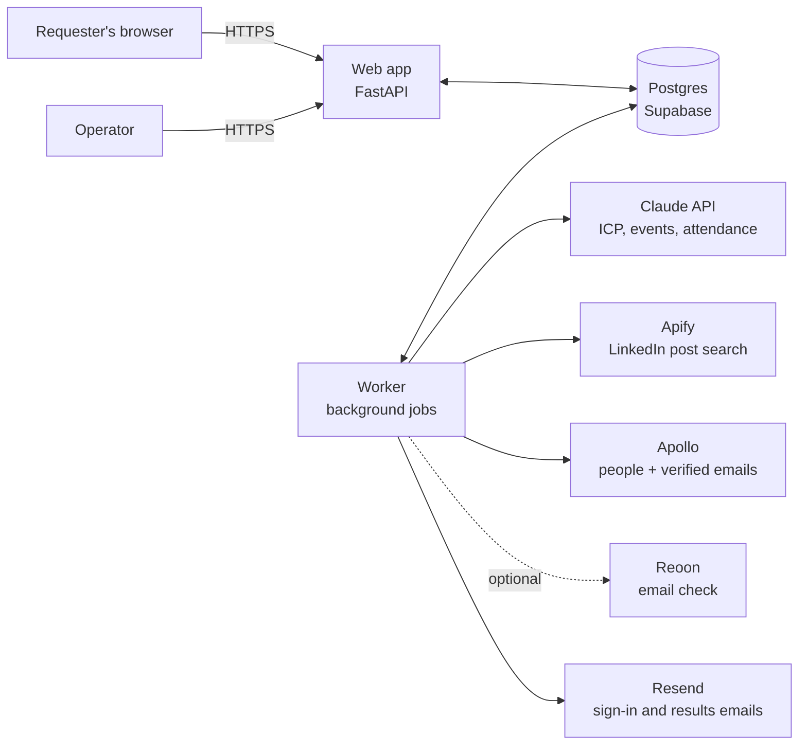
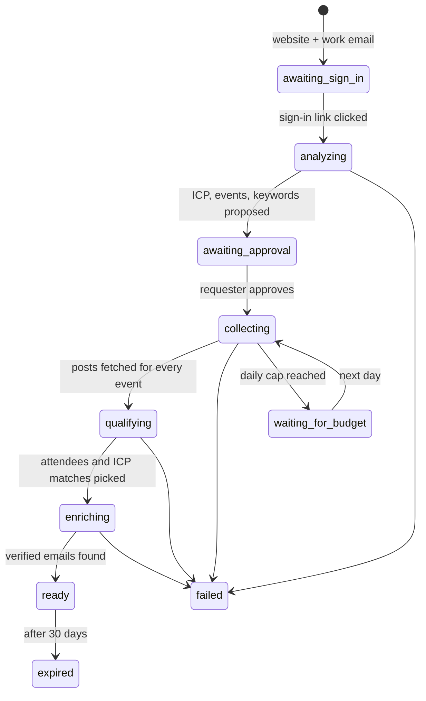

# Architecture

## The big picture

Two processes from one codebase and one Docker image:

- **Web** serves pages and the operator console. It never calls an outside service, not even to send email: it writes
  jobs (and outbox emails) to the database, and the worker does the rest. A slow or failing provider therefore can't
  slow down or break a page.
- **Worker** runs the pipeline as a sequence of jobs. Several workers can run at once.

Postgres is the only stateful piece. It holds the data, the job queue, the spend ledger and the rate-limit counters,
so there is no Redis to run (see [ADR 0002](adr/0002-postgres-job-queue.md)).

## The pipeline

Each run moves through these states. Every arrow is one background job, and every job can safely run twice.

1. **analyze**, two jobs. `analyze_site` reads the home page and up to four pages about the customers (see Security)
   and asks Claude for the ICP; a site that can't be read, or has too little text, fails the run with the reason
   instead of a guess. `find_events` asks Claude, with live web search, for real events, and builds up to four
   LinkedIn searches per event. Results are stored on the run for the requester to edit. Both jobs stay within the
   analysis budget, the only spend before approval.
2. **collect**, one `collect_event` job per approved event (at most three). A search any run made for the same event
   in the last `SEARCH_CACHE_DAYS` (3) is reused, and a run waits for another run's search of the event rather than
   pay for the same posts; the rest go into one Apify run capped by `maxTotalChargeUsd`. The job stores the Apify
   run's id before polling it, so a worker that stops mid-search picks the same run back up. Posts, which search
   found each, and the searches themselves go into the shared cache. A search that fails or runs past 30 minutes is
   tried once more, then only its event is dropped; the run fails only if no event could be searched.
3. **qualify**, one `qualify` job per run. Text rules label the obvious posts for free (`app/pipeline/rules.py`);
   Claude labels the rest, 25 posts per call, a few calls per turn of the job, which then defers to itself so other
   runs get a turn. Labels are cached per post and event, so a run reuses what earlier runs paid for. Company pages
   are never labeled. Each person who was there (attending, attended, speaking, exhibiting) becomes one candidate
   with their most telling post; anyone whose headline already rules them out (an excluded title, a student, the
   requester's own colleague) is kept with the reason and skipped by the paid steps.
4. **enrich**, one `enrich` job per run. Apollo bulk match by LinkedIn URL, 10 people per call, candidates whose
   headline fits a persona first. Whatever Apollo answers, found or not, is cached on the person for
   `PERSON_CACHE_DAYS` (30 days, as long as personal data may be kept), so other runs reuse it. When two runs ask
   about the same person at once, the answer to the later question is the one kept. The ICP score
   (`app/pipeline/scoring.py`) uses the enriched title, seniority, company industry and company size, and its
   reasons are kept on the lead. People without an email Apollo marks verified, with an excluded title, at the
   requester's company, or scoring below `MIN_ICP_SCORE` (40) are left out with the reason; the best 50 make the
   list. With Reoon on, those 50 addresses get a second check that removes only invalid, disabled and spam-trap
   addresses. Like qualify, the job makes a few calls per turn, then defers to itself.
5. **deliver**: the run is marked ready (results kept for 30 days) and a `deliver` job emails the requester the
   link, with `results:<run id>` as Resend's idempotency key. A send that would come more than 23 hours after the
   run was ready is dropped instead, since Resend only remembers a key for 24.

### How the worker runs jobs

- One job at a time per worker process; add processes for throughput. Jobs are claimed with `SKIP LOCKED`.
- A handler reads what it needs and commits **before** any slow outside call, then writes its results; the worker
  commits those together with the job's completion. No transaction stays open while a provider answers (production
  enforces this: Postgres ends a session idle in a transaction for 60 seconds).
- Paid calls follow ADR 0002: reserve, mark started, call, then settle or release by what the failure (or answer)
  says it cost. A retried step first closes what its earlier attempt left open.
- A heartbeat thread keeps a long job's claim fresh. Every minute the worker puts back jobs whose worker went silent
  (5 minutes by default; on the last attempt the job gives up, which fails its run) and closes spend reservations
  left open for over an hour.
- A worker that lost its claim to another (it was too slow) drops its writes; the new owner redoes the work.

## Data model (main tables)

| Table | Holds |
|---|---|
| `accounts`, `login_tokens`, `sessions` | Requesters and operators; one-time sign-in tokens and sessions, stored hashed |
| `runs` | One per company request: website, status, ICP, proposed and approved events, cost so far |
| `events`, `run_events` | Canonical events, and which events (and keywords) a run uses |
| `posts`, `event_posts`, `search_cache` | The shared post cache and which searches already ran |
| `post_labels` | Attendance label per post and event, with the method (rule or model) |
| `people` | One row per LinkedIn profile with cached Apollo data |
| `run_leads` | The final list for a run, with ICP score and reasons |
| `jobs` | The job queue |
| `spend`, `budget_days` | Every paid call, and the running total per day for the daily cap |
| `rate_limits` | Fixed-window counters for sign-up and sign-in attempts |
| `outbox_emails` | Emails kept instead of sent where there's no Resend key: local work and previews |

## Cost controls

- Nothing runs before the requester signs in. The analyze step then runs before approval, because it produces the
  plan the requester approves. It calls only Claude, has its own cap ($0.50, part of the run's $3) and counts toward
  the daily cap. Apify, Apollo and Reoon run only after the requester approves.
- Dollar-billed calls (Apify, Claude) first **reserve** their estimated cost against the run's cap and the day's cap in one database
  transaction (row lock on today's budget), so two workers can't both squeeze under the limit. Actual cost is
  settled afterwards.
- Apify runs carry `maxTotalChargeUsd`, so even a runaway search can't exceed its reservation.
- Credit-billed calls have their own per-run limits: Apollo credits (150 per run, one per person found; a batch
  never asks about more people than the credits left) and, when enabled, Reoon checks (one per place on the list,
  at most 50). Resend's free tier covers our email volume; sign-ins are rate-limited per IP and email.
- Caches mean popular events and people are paid for once.

## Scaling to 10,000 users

The web tier is stateless; add replicas. The real limits are external:

| Constraint | At 500 runs/day | Plan |
|---|---|---|
| Apify spend | ≈ 300,000 posts/day before caching | Event cache, query caps, daily budget |
| Apollo | ≈ 75,000 lookups/day before caching | Person cache, ICP pre-screen before lookup |
| Claude | ≈ 15,000 classification calls/day | Rules first, batches of 25 posts, label cache |
| Postgres connections | Supabase pooler limits | Small pools per process (5 + 5 overflow) |
| Database size | ≈ 1 MB per run | 30-day retention for results and raw posts; Supabase Pro at scale |

A load test in the QA repo checks the web tier at 500 concurrent users and the queue with 1,000 runs (fake providers).

## Security

- **Sign-in:** one-time links, hashed in the database, 30-minute expiry, single use. The worker makes the token when
  it sends the email, so it never passes through the web process, the job queue or a log (uvicorn's access log, which
  would record it, is off). The link opens a page whose button signs in, so mail scanners that open links can't use
  them up. Sessions are random tokens in an HttpOnly, Secure, SameSite=Lax cookie, stored hashed and revocable.
- **Sign-up abuse:** the form takes 5 attempts an hour per IP address and per email address (kept as a hash), and a
  company's free run is taken under a lock on its domain, so two colleagues signing in at once can't both use it.
- **Authorization:** a run and its leads are visible only to the account that created it and to operators
  (`ADMIN_EMAILS`). Anyone else gets "not found", so run ids can't be probed.
- **CSRF:** every form carries a token that must match a cookie only our pages set (double submit), so a form
  posted from another site is refused.
- **SSRF:** the website fetcher resolves the host itself, refuses private, loopback, link-local and reserved
  addresses, connects to the address it checked (no DNS rebinding), re-checks every redirect, and caps size and time.
- **Headers:** strict Content-Security-Policy, HSTS, no framing.
- **Secrets:** only in environment variables (Railway); never in the repo or logs.
- **Logs:** identify people by internal IDs (account, run, person). Lead data (names, emails, LinkedIn URLs),
  requesters' email addresses and sign-in links are never logged. A sign-up attempt over the limit is logged without
  who made it; the `rate_limits` table shows which IP address or address hash went over.
- **Data retention:** personal data in results and caches is deleted after 30 days.

## Environments

| Environment | Where | Providers | Database |
|---|---|---|---|
| Local | your machine | fakes | local Postgres |
| Preview | Railway, one per pull request | fakes | Railway Postgres (throwaway) |
| Staging | Railway `staging` | real, tiny caps | separate database |
| Production | Railway `production`, `events.theb2bdynamics.com` | real | Supabase |

Fakes are deterministic stand-ins for every provider, so previews and the QA suite can run the whole pipeline end to
end without spending money ([ADR 0003](adr/0003-providers-behind-interfaces.md)).

## Observability

JSON logs with request, run and job IDs; error tracking in Sentry; `/healthz` (process up) and `/readyz` (database
reachable) for Railway's health checks; the operator console for run and spend status.
